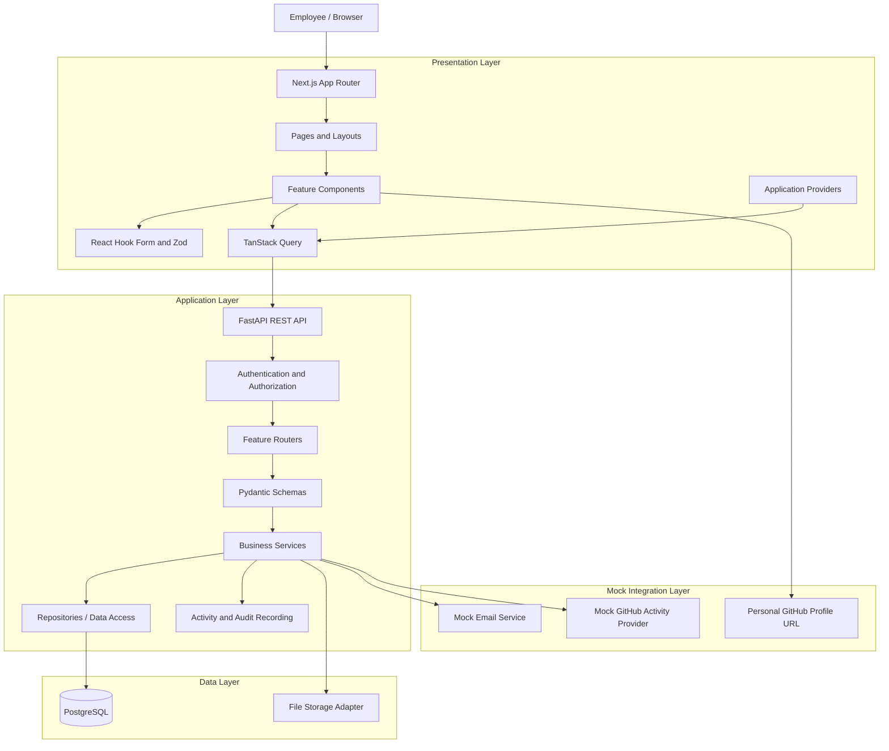
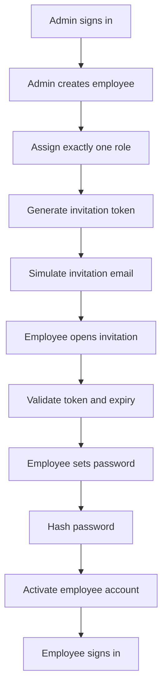
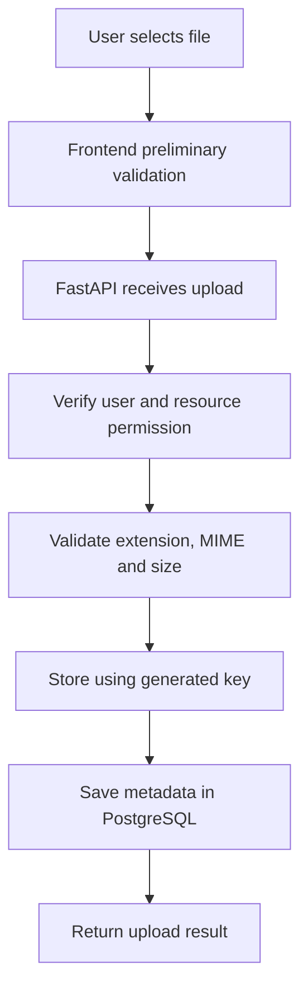
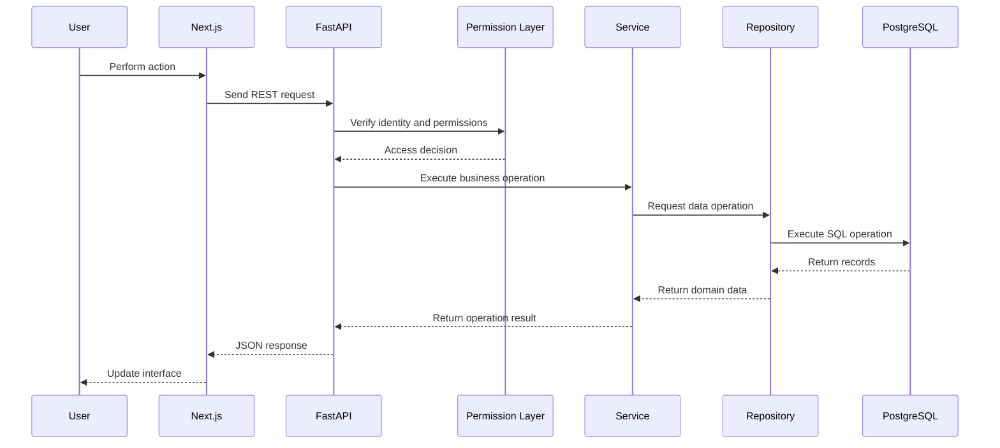

# AgriBid WorkSphere
# System Architecture Document

| Attribute | Details |
|---|---|
| Project | AgriBid WorkSphere |
| Document | System Architecture |
| Version | 1.0 |
| Date | 12 November 2026 |
| Status | Draft for Senior Review |
| Architecture Type | Layered Web Application with Modular Backend |
| Primary Source | Complete Project Development Assignment and approved scope changes |

## 1. Purpose

This document defines the proposed technical architecture of AgriBid WorkSphere.

It describes:
- System components.
- Frontend architecture.
- Backend architecture.
- Database architecture.
- API communication.
- Authentication and authorization boundaries.
- External integration boundaries.
- File storage.
- Security considerations.
- Development environment.

The architecture is based on the original assignment and approved senior clarifications.

Any implementation choice not explicitly required by the assignment is identified as a proposal requiring technical review.

## 2. Architecture Overview

AgriBid WorkSphere uses a three-layer application architecture:

1. Presentation Layer - Next.js frontend.
2. Application Layer - FastAPI backend.
3. Data Layer - PostgreSQL database.

External integration boundaries are provided for:
- Email service simulation.
- GitHub activity data.
- File storage.

The current assignment uses local development and mock integration data.

Production hosting is excluded.

## 3. Technology Stack

### 3.1 Frontend

| Technology | Responsibility |
|---|---|
| Next.js App Router | Web application and routing |
| React | UI components |
| TypeScript | Static type checking |
| Tailwind CSS | Styling |
| shadcn/ui | Reusable UI components |
| Motion | UI animations |
| TanStack Query | Server-state management |
| React Hook Form | Form management |
| Zod | Frontend schema validation |
| Zustand | Client-side global state where required |
| Lucide React | Icons |

### 3.2 Backend

| Technology | Responsibility |
|---|---|
| Python | Backend programming language |
| FastAPI | REST API framework |
| Pydantic | Request and response validation |

### 3.3 Database

| Technology | Responsibility |
|---|---|
| PostgreSQL | Persistent relational data |

### 3.4 Optional Infrastructure

Redis may be considered for caching or background processing only when technically justified.

It is not required for the initial application foundation.

### 3.5 Additional Proposed Implementation Tools

The following are proposed choices, not explicit technology mandates from the PDF:

- SQLAlchemy for PostgreSQL data access.
- Alembic for database migrations.
- Pytest for backend testing.
- HTTPX for API integration testing.

These choices should follow company coding conventions if different standards exist.

## 4. High-Level System Architecture



## 5. Presentation Layer - Frontend Architecture

### 5.1 Responsibilities

The frontend is responsible for:
- Rendering application pages.
- Authentication forms and user interactions.
- Dashboard layouts.
- Role-aware navigation.
- Form input and client-side validation.
- Data fetching and caching.
- Loading, empty and error states.
- User feedback.
- Responsive behavior.

The frontend must not be treated as the security boundary.

### 5.2 Routing Architecture

Proposed route groups:

Authentication:
- /sign-in
- /invitation
- /forgot-password
- /reset-password

Authenticated application:
- /dashboard
- /users
- /users/[userId]
- /teams
- /teams/[teamId]
- /projects
- /projects/[projectId]
- /tickets
- /tickets/[ticketId]
- /board
- /calendar
- /backlog
- /sprints
- /reports
- /github
- /audit-logs
- /settings

Exact routes may be refined during the UI specification.

### 5.3 Feature-Based Organization

Frontend features should be independently organized.

Proposed features:
- auth
- users
- teams
- projects
- tickets
- comments
- attachments
- activities
- sprints
- reports
- github
- audit-logs

### 5.4 Frontend Data Management

TanStack Query will manage server state:
- API requests.
- Cached responses.
- Loading states.
- Error states.
- Cache invalidation.
- Refetching after successful operations.

Zustand should only hold client-side global state where necessary.

Do not duplicate all API records in Zustand.

### 5.5 Form Management

React Hook Form will manage form state.

Zod will define frontend validation schemas.

Validation must be repeated independently by FastAPI.

### 5.6 UI Components

shadcn/ui will provide reusable components:
- Button.
- Input.
- Card.
- Dialog.
- Table.
- Select.
- Checkbox.
- Dropdown.
- Badge.
- Alert.
- Skeleton.

Tailwind CSS will maintain visual consistency.

Motion will be used only for meaningful transitions.

## 6. Application Layer - Backend Architecture

### 6.1 Responsibilities

FastAPI is responsible for:
- Receiving frontend API requests.
- Authentication.
- Authorization.
- Business-rule validation.
- Database operations.
- Ticket workflow enforcement.
- File metadata management.
- GitHub mock data handling.
- Activity and audit record creation.
- Consistent API responses and errors.

### 6.2 Modular Backend Structure

Proposed modules:

| Module | Responsibility |
|---|---|
| auth | Login, logout, invitations and password management |
| users | Employee administration |
| roles | Role definitions |
| permissions | Access-control rules |
| teams | Team operations and memberships |
| projects | Project management |
| project_members | Project membership |
| tickets | Ticket creation, assignment and transitions |
| ticket_comments | Comments and replies |
| attachments | Upload, metadata and download authorization |
| ticket_activities | Ticket history |
| sprints | Sprint and backlog operations |
| reports | Project, team and sprint reporting |
| github | Mock repositories, branches, commits and PRs |
| audit_logs | System audit records |

The Notifications module is excluded from the current assignment.

### 6.3 Layer Separation

Each feature module should follow this responsibility model.

```text
HTTP Request
     |
     v
Router / Controller
     |
     v
Authentication and Permission Dependencies
     |
     v
Pydantic Request Schema
     |
     v
Service Layer
     |
     v
Repository / Data Access
     |
     v
SQLAlchemy Model
     |
     v
PostgreSQL
```

### 6.4 Router / Controller

Responsibilities:
- Define HTTP endpoints.
- Accept requests.
- Read path/query/body parameters.
- Apply authentication and permission dependencies.
- Call business services.
- Return response schemas.

Router files should not contain large business workflows or directly manipulate database records.

### 6.5 Schema Layer

Responsibilities:
- Request validation.
- Response serialization.
- Field constraints.
- Type checking.
- Safe exposure of response fields.

Password hashes and internal credentials must never be included in user-facing schemas.

### 6.6 Service Layer

Responsibilities:
- Business rules.
- Permission-aware operations.
- Ticket state transitions.
- Assignment validation.
- Multi-step transactions.
- Activity and audit orchestration.
- Integration coordination.

Business rules must not exist only in frontend components.

### 6.7 Repository Layer

Responsibilities:
- Database queries.
- Create/read/update operations.
- Relationship loading.
- Filtering and pagination.
- Database persistence.

### 6.8 Model Layer

Responsibilities:
- Database table definitions.
- Primary keys.
- Foreign keys.
- Relationships.
- Constraints.
- Indexes.

## 7. Authentication and Authorization Architecture

### 7.1 Authentication Flow

Proposed invitation workflow:



Invalid, expired, reused or revoked invitation tokens must be rejected.

### 7.2 Role Model

Supported roles:
- Admin.
- Project Manager.
- Developer.
- Tester.

Exactly one role is associated with each employee.

### 7.3 Team Membership

An employee can belong to multiple teams.

A many-to-many relationship is required between users and teams through team_members.

### 7.4 Backend Authorization

Each protected API request must check:
1. Authentication.
2. Active employee status.
3. Assigned role.
4. Required action permission.
5. Resource/project access.
6. Business-specific conditions.

### 7.5 Ticket Transition Authorization

The transition service must enforce:

| Actor | Permitted transition |
|---|---|
| Admin | Any configured transition |
| PM | Any configured transition within authorized projects |
| Developer | TODO → IN_PROGRESS |
| Developer | TODO → IN_REVIEW |
| Tester | TESTING → TESTING_DONE |
| Tester | TESTING → BUG_FIXED |
| Bug-fix workflow | BUG_FIXED → COMPLETED |

The actor responsible for the final BUG_FIXED-to-COMPLETED transition must follow the approved workflow decision.

TESTING_DONE and COMPLETED remain separate statuses.

## 8. Database Architecture

### 8.1 Database

PostgreSQL is the primary persistent data store.

### 8.2 Proposed Entity Groups

Identity:
- users.
- roles.
- permissions.
- role_permissions.
- auth_sessions or approved session storage.
- invitation_tokens.
- password_reset_tokens.

Teams:
- teams.
- team_members.

Projects:
- projects.
- project_members.

Tickets:
- tickets.
- ticket_labels.
- labels.
- ticket_relationships.
- ticket_assignments where assignment history requires it.

Collaboration:
- ticket_comments.
- comment_mentions.
- attachments.
- ticket_activities.

Agile:
- sprints.
- sprint_tickets.

GitHub:
- github_repositories.
- github_branches.
- github_commits.
- github_pull_requests.

Auditing:
- audit_logs.

The notifications tables are excluded from the current implementation.

### 8.3 Important Relationship Decisions

- One user has exactly one role through a required role reference.
- Do not implement a user_roles many-to-many table.
- Users and teams are many-to-many.
- Users and projects are many-to-many.
- A project can contain multiple tickets.
- A ticket belongs to a project.
- A ticket can have comments, attachments and activity records.
- A ticket may have an optional parent ticket.
- Projects may have multiple sprints.
- Sprint membership is maintained through sprint_tickets.

Exact ticket-assignee multiplicity requires no assumption beyond the approved ticket fields.

### 8.4 Database Constraints

- Primary keys.
- Foreign keys.
- Unique employee email.
- Unique project key.
- Unique ticket identifier.
- Unique active team membership.
- Valid date constraints.
- Appropriate indexes.
- Transaction integrity.

### 8.5 Migrations

Use a database migration mechanism such as Alembic if approved by the company.

Do not modify the database schema manually without documenting and reproducing the changes through migrations.

## 9. File Storage Architecture

### 9.1 Storage Boundary

File binaries must not be stored directly in PostgreSQL.

PostgreSQL stores attachment metadata.

A storage adapter handles binary storage.

### 9.2 Attachment Limits

- Maximum five documents; exact count scope remains subject to confirmation.
- Maximum 5 MB per individual file.

### 9.3 File Types

JPG, JPEG, PNG, WEBP, PDF, XLS, XLSX, CSV, DOC and DOCX.

### 9.4 Upload Process



Storage and database failures must have defined cleanup/recovery behavior.

### 9.5 Storage Provider

The company-approved storage provider is not specified.

Keep the provider behind an adapter. Use only an approved local-development storage method until a provider is selected.

The production object-storage architecture remains to be finalized.

## 10. External Integration Architecture

### 10.1 Email Integration

Current assignment behavior:
- Use dummy company employee addresses.
- Example: name@agribid.ai.
- Simulate invitation delivery.
- Simulate password-reset delivery.
- Do not claim actual email delivery.

Create a replaceable email adapter so a future company email provider can be connected without rewriting authentication services.

### 10.2 GitHub Account Button

The toolbar GitHub button must open the developer's configured personal GitHub URL.

The public GitHub URL is configuration, not a secret.

Do not expose passwords, tokens or private credentials in client-side code.

### 10.3 Mock GitHub Activity

Use mock data for:
- Repository information.
- Branches.
- Commits.
- Pull requests.
- Commit/ticket relationships.
- Pull-request status.

Keep these operations within a GitHub integration module.

Real company GitHub Enterprise OAuth, webhooks and credentials are not assumed for this initial mock-data implementation.

## 11. Audit and Activity Architecture

Two distinct concepts remain in scope.

### Ticket Activity

Records activity belonging to a ticket:
- Creation.
- Changes.
- Assignment.
- Priority/status updates.
- Comments.
- Attachments.
- Completion.

### System Audit Logs

Records important system-wide actions:
- User creation.
- Role changes.
- Team creation.
- Project creation/updates.
- Ticket actions.
- Repository configuration.
- Permission changes.

Audit records must not be editable by ordinary users.

## 12. Excluded Architecture Components

The following components are excluded from the current implementation:

1. Notifications module.
2. Notification APIs.
3. Notification database tables.
4. Notification background jobs.
5. Notification panel, bell and unread count.
6. Automate Pro and automation UI/functionality.
7. Production hosting and deployment.
8. Real email delivery during mock development.
9. Real GitHub Enterprise OAuth/webhook integration during mock development.

Ticket activity and audit logs are not excluded.

## 13. API Communication Architecture

### 13.1 Communication

The frontend communicates with FastAPI through REST APIs.

The backend communicates with PostgreSQL through a controlled data-access layer.

### 13.2 API Versioning

Proposed API prefix:

/api/v1

### 13.3 Request Lifecycle



### 13.4 API Requirements

Every endpoint must define:
- HTTP method.
- URL.
- Authentication.
- Required permission.
- Request schema.
- Response schema.
- Validation rules.
- Success status codes.
- Error status codes.

### 13.5 Error Responses

Use a consistent error contract.

Do not expose internal stack traces, database errors or secrets.

## 14. Security Architecture

Mandatory security considerations:
- Secure password hashing.
- Backend RBAC.
- Session/token management.
- Request validation.
- SQL injection protection.
- XSS protection.
- CSRF protection where applicable.
- CORS configuration.
- Rate limiting.
- Secure file handling.
- Controlled downloads.
- Environment configuration.
- Secret protection.
- Safe API errors.
- Audit integrity.

Exact authentication transport, cookie/session lifetime, hashing configuration and other security parameters require technical approval.

## 15. Local Development Architecture

The current application will run locally.

Proposed local services:

| Component | Local Address |
|---|---|
| Next.js | http://localhost:3000 |
| FastAPI | http://localhost:8000 |
| FastAPI OpenAPI | http://localhost:8000/docs |
| PostgreSQL | localhost:5432 |
| Database | agribid_worksphere |

The final local API proxy, CORS and cookie configuration will be documented during implementation.

Production hosting is outside the present assignment scope.

## 16. Proposed Backend Request Boundaries

The backend should ensure that:
- Routers do not implement large business workflows.
- Schemas do not contain database persistence operations.
- Services do not depend on browser-specific code.
- Repositories do not make authorization decisions without service/dependency context.
- Integrations are isolated behind dedicated modules.
- Database transactions cover related operations.

## 17. Architecture Quality Requirements

The architecture should provide:
- Security.
- Modularity.
- Separation of concerns.
- Testability.
- Maintainability.
- Data integrity.
- Consistent API behavior.
- Controlled integrations.
- Performance measurement.
- Clear error handling.

## 18. Architecture Decisions Requiring Review

| ID | Decision | Current Position |
|---|---|---|
| ARC-001 | Database ORM | SQLAlchemy proposed |
| ARC-002 | Migration tool | Alembic proposed |
| ARC-003 | Authentication transport | Requires security approval |
| ARC-004 | Cookie/session expiry | Requires security approval |
| ARC-005 | File storage provider | TBD |
| ARC-006 | Local file storage adapter | Proposed for development only |
| ARC-007 | Password hashing parameters | Requires security approval |
| ARC-008 | API proxy/CORS arrangement | To be finalized |
| ARC-009 | Ticket assignee multiplicity | Follow approved business rule |
| ARC-010 | GitHub public profile URL | Configure after developer confirms URL |
| ARC-011 | BUG_FIXED to COMPLETED actor | Requires senior confirmation |

## 19. Document Approval

This architecture document is a proposed technical design baseline.

It must be reviewed against:
- Project Overview.
- SRS.
- Functional Requirements.
- Non-functional Requirements.
- Role-Permission Matrix.
- Approved Scope Changes.
- Use Case Catalogue.
- Validation and Edge Case Catalogue.

Architecture decisions must be updated when approved requirements change.

---
End of Document


## Technology decision reference - 12 November 2026

The detailed selected toolchain and architectural choices are maintained in `./technology-decisions.md`.

The canonical role-based ticket workflow is maintained in `../workflows/ticket-workflow.md`.

Redis is not part of the initial local implementation because no confirmed requirement currently justifies it.


## Authoritative workflow update — 12 November 2026

The latest workflow is defined in `../workflows/ticket-workflow.md`.

Follow the original PDF's default path:

`BACKLOG` → `TODO` → `IN_PROGRESS` → `IN_REVIEW` → `TESTING` → `COMPLETED`.

Developer moves `TODO` to `IN_PROGRESS`, then `IN_PROGRESS` to `IN_REVIEW`. Do not use the earlier draft's direct `TODO` to `IN_REVIEW` permission.

Tester may return failed testing to `IN_PROGRESS` or `REOPENED` with a comment. Tester can mark `REOPENED`; the ticket can return to Developer work in `IN_PROGRESS`.

Admin and PM can manage `BLOCKED`, `REOPENED` and `CANCELLED` and retain their any-status authority.

`BUG_FIXED` proceeds to `COMPLETED`. `TESTING_DONE` remains distinct from `COMPLETED`.
