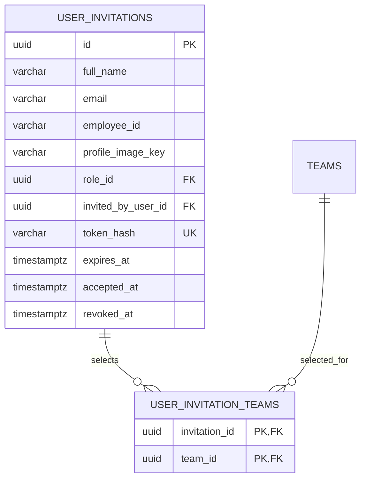

# AgriBid WorkSphere
# Entity Relationship Diagram (ERD)

Version: 1.0
Date: 12 November 2026
Status: Draft for Senior Review

## 1. Overview

This ERD represents the proposed PostgreSQL database relationships.

It follows:
- One role per employee.
- Multiple team memberships.
- Multiple project memberships.
- Project-owned tickets and sprints.
- Ticket comments, attachments and activities.
- Mock GitHub repository activity.
- Separate system audit logs.

Notifications entities are intentionally excluded.

## 2. Logical ER Diagram

```mermaid
erDiagram
    ROLES ||--o{ USERS : assigned_to
    ROLES ||--o{ ROLE_PERMISSIONS : grants
    PERMISSIONS ||--o{ ROLE_PERMISSIONS : contains

    USERS ||--o{ USER_INVITATIONS : invited_by
    USERS o|--o{ USER_INVITATIONS : accepted_by
    USER_INVITATIONS ||--o{ USER_INVITATION_TEAMS : selects
    TEAMS ||--o{ USER_INVITATION_TEAMS : selected_for
    USERS ||--o{ PASSWORD_RESET_TOKENS : owns
    USERS ||--o{ AUTH_SESSIONS : maintains

    USERS ||--o{ TEAM_MEMBERS : joins
    TEAMS ||--o{ TEAM_MEMBERS : contains
    USERS ||--o{ TEAMS : leads

    USERS ||--o{ PROJECTS : manages
    TEAMS ||--o{ PROJECTS : assigned_to
    PROJECTS ||--o{ PROJECT_MEMBERS : contains
    USERS ||--o{ PROJECT_MEMBERS : joins

    PROJECTS ||--o{ TICKETS : contains
    TICKET_STATUSES ||--o{ TICKETS : defines
    USERS ||--o{ TICKETS : reports
    USERS ||--o{ TICKETS : assigned
    USERS ||--o{ TICKETS : reviews
    USERS ||--o{ TICKETS : tests
    TICKETS o|--o{ TICKETS : parent_of

    TICKET_STATUSES ||--o{ WORKFLOW_TRANSITIONS : source
    TICKET_STATUSES ||--o{ WORKFLOW_TRANSITIONS : target
    ROLES ||--o{ WORKFLOW_TRANSITIONS : authorizes

    TICKETS ||--o{ TICKET_ASSIGNMENTS : history
    USERS ||--o{ TICKET_ASSIGNMENTS : assigned_to
    USERS ||--o{ TICKET_ASSIGNMENTS : assigned_by

    TICKETS ||--o{ TICKET_LABELS : tagged
    LABELS ||--o{ TICKET_LABELS : applied

    TICKETS ||--o{ TICKET_RELATIONSHIPS : source
    TICKETS ||--o{ TICKET_RELATIONSHIPS : target

    TICKETS ||--o{ TICKET_COMMENTS : contains
    USERS ||--o{ TICKET_COMMENTS : writes
    TICKET_COMMENTS o|--o{ TICKET_COMMENTS : replies_to
    TICKET_COMMENTS ||--o{ COMMENT_MENTIONS : contains
    USERS ||--o{ COMMENT_MENTIONS : mentioned

    PROJECTS o|--o{ ATTACHMENTS : contains
    TICKETS o|--o{ ATTACHMENTS : contains
    USERS ||--o{ ATTACHMENTS : uploads

    TICKETS ||--o{ TICKET_ACTIVITIES : records
    USERS o|--o{ TICKET_ACTIVITIES : performs

    PROJECTS ||--o{ SPRINTS : schedules
    SPRINTS ||--o{ SPRINT_TICKETS : contains
    TICKETS ||--o{ SPRINT_TICKETS : planned

    PROJECTS ||--o{ GITHUB_REPOSITORIES : connects
    GITHUB_REPOSITORIES ||--o{ GITHUB_BRANCHES : contains
    GITHUB_REPOSITORIES ||--o{ GITHUB_COMMITS : contains
    GITHUB_REPOSITORIES ||--o{ GITHUB_PULL_REQUESTS : contains
    TICKETS o|--o{ GITHUB_COMMITS : linked_to
    TICKETS o|--o{ GITHUB_PULL_REQUESTS : linked_to

    USERS o|--o{ AUDIT_LOGS : performs

    ROLES {
        uuid id PK
        varchar code UK
        varchar name
    }

    USERS {
        uuid id PK
        uuid role_id FK
        varchar full_name
        varchar email UK
        varchar password_hash
        boolean is_active
        timestamptz created_at
    }

    PERMISSIONS {
        uuid id PK
        varchar code UK
        varchar resource
        varchar action
    }

    ROLE_PERMISSIONS {
        uuid role_id PK,FK
        uuid permission_id PK,FK
    }

    TEAMS {
        uuid id PK
        varchar name
        uuid lead_user_id FK
        varchar status
    }

    TEAM_MEMBERS {
        uuid id PK
        uuid team_id FK
        uuid user_id FK
        timestamptz joined_at
        timestamptz removed_at
    }

    PROJECTS {
        uuid id PK
        varchar project_key UK
        varchar name
        uuid manager_id FK
        uuid assigned_team_id FK
        varchar status
    }

    PROJECT_MEMBERS {
        uuid id PK
        uuid project_id FK
        uuid user_id FK
    }

    TICKET_STATUSES {
        uuid id PK
        varchar status_key UK
        varchar display_name
    }

    TICKETS {
        uuid id PK
        uuid project_id FK
        uuid status_id FK
        uuid reporter_id FK
        uuid assignee_id FK
        uuid reviewer_id FK
        uuid tester_id FK
        uuid parent_ticket_id FK
        varchar ticket_key UK
        varchar title
        varchar priority
    }

    WORKFLOW_TRANSITIONS {
        uuid id PK
        uuid from_status_id FK
        uuid to_status_id FK
        uuid role_id FK
        boolean is_active
    }

    TICKET_ASSIGNMENTS {
        uuid id PK
        uuid ticket_id FK
        uuid previous_user_id FK
        uuid new_user_id FK
        uuid assigned_by FK
        varchar assignment_type
    }

    LABELS {
        uuid id PK
        uuid project_id FK
        varchar name
    }

    TICKET_LABELS {
        uuid ticket_id PK,FK
        uuid label_id PK,FK
    }

    TICKET_RELATIONSHIPS {
        uuid id PK
        uuid source_ticket_id FK
        uuid target_ticket_id FK
        varchar relationship_type
    }

    TICKET_COMMENTS {
        uuid id PK
        uuid ticket_id FK
        uuid author_id FK
        uuid parent_comment_id FK
        text body
    }

    COMMENT_MENTIONS {
        uuid id PK
        uuid comment_id FK
        uuid mentioned_user_id FK
    }

    ATTACHMENTS {
        uuid id PK
        uuid project_id FK
        uuid ticket_id FK
        uuid uploaded_by FK
        varchar storage_key UK
        bigint size_bytes
    }

    TICKET_ACTIVITIES {
        uuid id PK
        uuid ticket_id FK
        uuid actor_id FK
        varchar action
        jsonb metadata
    }

    SPRINTS {
        uuid id PK
        uuid project_id FK
        varchar name
        date start_date
        date end_date
    }

    SPRINT_TICKETS {
        uuid id PK
        uuid sprint_id FK
        uuid ticket_id FK
    }

    GITHUB_REPOSITORIES {
        uuid id PK
        uuid project_id FK
        varchar repository_name
        varchar repository_url
    }

    GITHUB_BRANCHES {
        uuid id PK
        uuid repository_id FK
        varchar branch_name
    }

    GITHUB_COMMITS {
        uuid id PK
        uuid repository_id FK
        uuid ticket_id FK
        varchar commit_sha
    }

    GITHUB_PULL_REQUESTS {
        uuid id PK
        uuid repository_id FK
        uuid ticket_id FK
        integer pr_number
        varchar state
    }

    AUDIT_LOGS {
        uuid id PK
        uuid actor_id FK
        varchar action
        varchar resource_type
        uuid resource_id
        jsonb metadata
    }

    USER_INVITATIONS {
        uuid id PK
        varchar email
        varchar full_name
        varchar employee_id
        varchar profile_image_key
        uuid role_id FK
        uuid invited_by_user_id FK
        uuid accepted_user_id FK
        varchar token_hash UK
        timestamptz expires_at
        timestamptz accepted_at
        timestamptz revoked_at
    }

    USER_INVITATION_TEAMS {
        uuid invitation_id PK,FK
        uuid team_id PK,FK
    }

    PASSWORD_RESET_TOKENS {
        uuid id PK
        uuid user_id FK
        varchar token_hash UK
        timestamptz expires_at
    }

    AUTH_SESSIONS {
        uuid id PK
        uuid user_id FK
        varchar token_hash UK
        timestamptz expires_at
    }
```

## 3. Important Relationship Explanations

### Identity
- One role can be assigned to many employees.
- Each employee has exactly one role.
- Roles and permissions have a many-to-many relationship.

### Teams
- One team contains multiple employees.
- One employee can belong to multiple teams.
- team_members resolves the many-to-many relationship.

### Projects
- A project has a manager and an assigned team.
- Projects can have multiple members.
- Employees can participate in multiple projects.

### Tickets
- Each ticket belongs to one project.
- Each ticket has a status.
- Each ticket has a reporter.
- Assignee, reviewer and tester are separate user references.
- Tickets may have optional parent relationships.
- Ticket assignments preserve assignment history.

### Collaboration
- A ticket has multiple comments.
- Comments can have replies.
- Comments can mention multiple users.
- A ticket can have multiple attachments and activities.

### Agile
- A project has multiple sprints.
- Sprints contain tickets through sprint_tickets.

### GitHub
- A project can connect to multiple repositories.
- Repositories contain branches, commits and pull requests.
- Commits and pull requests can reference tickets.

### Auditing
- Audit records reference the acting user where available.
- Audit records are not editable by normal users.

## 4. Business Rules Represented in the ERD

1. One role per employee.
2. Multiple team memberships allowed.
3. Multiple project memberships allowed.
4. Project keys must be unique.
5. Ticket keys must be unique.
6. Ticket parent-child relationships must be valid.
7. TESTING_DONE is different from COMPLETED.
8. BUG_FIXED leads to COMPLETED.
9. Five documents maximum, with exact count scope pending confirmation.
10. Maximum 5 MB per individual document.
11. Notification entities are excluded.
12. Automate Pro entities are excluded.
13. GitHub activity initially uses mock records.

## 5. ERD Review Notes

The diagram represents a logical design, not finalized migration SQL.

Review these points before implementation:
- Ticket assignee multiplicity.
- Assignment history behavior.
- Team lead reassignment.
- Attachment count scope.
- Attachment retention.
- Sprint membership history.
- Workflow transition actor for BUG_FIXED -> COMPLETED.
- Project and team deletion policies.

---
End of ERD

## ERD clarification - 12 November 2026

Ensure the ERD reflects:
- The `COMPLETED` status replacing the former `DONE` status.
- Distinct `TESTING_DONE` status.
- Configured status transitions and role restrictions.
- An authentication-session entity linked to users.
- An invitation entity for invitation-only employee onboarding.

Use the canonical rules in `../workflows/ticket-workflow.md` and the architecture decisions in `../architecture/technology-decisions.md`.

Do not add notification entities for the excluded Notifications module.

## Authoritative workflow update — 12 November 2026

The latest workflow is defined in `../workflows/ticket-workflow.md`.

Follow the original PDF's default path:

`BACKLOG` → `TODO` → `IN_PROGRESS` → `IN_REVIEW` → `TESTING` → `COMPLETED`.

Developer moves `TODO` to `IN_PROGRESS`, then `IN_PROGRESS` to `IN_REVIEW`. Do not use the earlier draft's direct `TODO` to `IN_REVIEW` permission.

Tester may return failed testing to `IN_PROGRESS` or `REOPENED` with a comment. Tester can mark `REOPENED`; the ticket can return to Developer work in `IN_PROGRESS`.

Admin and PM can manage `BLOCKED`, `REOPENED` and `CANCELLED` and retain their any-status authority.

`BUG_FIXED` proceeds to `COMPLETED`. `TESTING_DONE` remains distinct from `COMPLETED`.

## 6. Implemented identity and pending invitation ERD clarification — 17 November 2026

The implemented schema uses `roles.code`, `permissions.code`, `auth_sessions.token_hash`, and `user_invitations` (not the earlier illustrative names `role_key`, `permission_key`, `session_token_hash`, and `invitations`).

The current `USER_INVITATIONS` entity is linked to role and inviter and stores email, token hash and lifecycle timestamps. It does not yet store the pending full name, optional employee ID or initial teams.

Before User Management invitation endpoints are implemented, extend the logical ERD with:

On successful acceptance, create the `USERS` record and corresponding `TEAM_MEMBERS` rows in one transaction, then set `accepted_at`. Store only the hash of the invitation token. This is a planned schema extension and must receive an Alembic migration before implementation; it is not part of the current applied migration.
